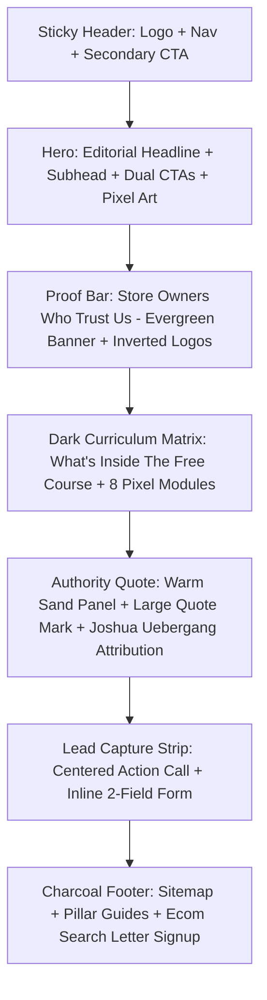

# Digital Darts Website Design System & Architecture Specification (`design.md`)

> **Source Study**: [Digital Darts (https://www.digitaldarts.com.au/)](https://www.digitaldarts.com.au/)  
> **Type**: B2B Ecommerce Agency / Shopify Plus Growth Consulting  
> **Audience**: 7 & 8-figure Shopify Founders, Heads of Ecommerce, Performance Marketers  
> **Core Identity**: Profit-First Authority, High-Converting Editorial Layout, Retro 8-bit / Pixel Accent Nuances  

---

## 1. Executive Summary & Brand Positioning

Digital Darts positions itself not as a generic digital agency, but as an elite, results-driven consultancy focusing on **real bottom-line net profit** rather than vanity metrics (like blended ROAS).

### Design Philosophy
- **Editorial Authority**: High-end typography pairing (authoritative serifs combined with clean humanistic sans-serifs) communicates prestige and intellectual rigor.
- **Retro-Tech Accents**: The brand incorporates distinctive **8-bit / pixelated mosaic dart motifs** and digital monospace/pixel numerals (`DotGothic16`), referencing precision, analytical targeting, and early web craftsmanship without feeling gimmicky.
- **Alternating High-Contrast Rhythm**: The page structure deliberately alternates between warm off-whites, bold emerald green, deep midnight obsidian, and golden sand panels. This rhythm guides the eye, prevents scroll fatigue, and partitions distinct cognitive stages of the conversion funnel.
- **Conversion-First UX**: Low friction, clear micro-commitments, abundant social proof, and distraction-free layouts.

---

## 2. Color Palette & Token System

Digital Darts avoids saturated neon hues in favor of rich, grounded organic tones: deep forest greens, crisp charcoal, warm cream, and obsidian black.

### Palette Table

| Role | Color Name | Hex Code | RGB | Usage |
| :--- | :--- | :--- | :--- | :--- |
| **Canvas Base** | Soft Slate / Off-White | `#E8E9EB` / `#F8F9FA` | `rgb(232, 233, 235)` | Page base background, subtle body framing |
| **Pure Surface** | Clean Card White | `#FFFFFF` | `rgb(255, 255, 255)` | Hero card backgrounds, form input fills |
| **Deep Obsidian** | Midnight Forest Black | `#09120E` | `rgb(9, 18, 14)` | Free Course / Curriculum dark container |
| **Brand Accent** | Deep Pine / Forest | `#16372D` | `rgb(22, 55, 45)` | Primary CTAs, active states, key headings |
| **Trust Emerald** | Rich Evergreen | `#0B5D44` | `rgb(11, 93, 68)` | Social proof / Client logo banner background |
| **Warm Authority** | Honey / Sand Tint | `#FEF3E2` | `rgb(254, 243, 226)` | Testimonial & founder quote card background |
| **Text Primary** | Deep Charcoal Ink | `#1C242C` | `rgb(28, 36, 44)` | Main headings (h1, h2, h3), primary labels |
| **Text Muted** | Slate Gray | `#4A5568` | `rgb(74, 85, 104)` | Body copy, subtitles, secondary metadata |
| **Text Inverse** | Snow White | `#FFFFFF` | `rgb(255, 255, 255)` | Text on dark emerald and obsidian sections |
| **Dark Copy Muted** | Light Silver Slate | `#A0AEC0` | `rgb(160, 174, 192)` | Descriptions inside the dark course block |
| **Pixel Art Sage** | Muted Mint Pixel | `#A9C4B7` / `#D5E4DE` | `rgb(169, 196, 183)` | Mosaic pixel decorations in hero & form |
| **Border Soft** | Subtle Gray Border | `#E2E8F0` | `rgb(226, 232, 240)` | Form input borders, subtle dividers |
| **Border Dark** | Dark Emerald Outline | `#1B3127` | `rgb(27, 49, 39)` | Outlined cards & borders in dark mode |

### Design Tokens (CSS Custom Properties)

```css
:root {
  /* Color Tokens */
  --color-bg-base: #f8f9fa;
  --color-bg-theme: #e8e9eb;
  --color-surface-white: #ffffff;
  --color-surface-dark: #09120e;
  --color-surface-quote: #fef3e2;
  --color-brand-pine: #16372d;
  --color-brand-evergreen: #0b5d44;
  --color-accent-mint: #a9c4b7;
  --color-text-main: #1c242c;
  --color-text-muted: #4a5568;
  --color-text-inverse: #ffffff;
  --color-text-dark-muted: #a0aec0;
  --color-border-light: #e2e8f0;
  --color-border-dark: #1b3127;

  /* Typography */
  --font-editorial: 'Merriweather', Georgia, serif;
  --font-sans: 'Open Sans', -apple-system, BlinkMacSystemFont, 'Segoe UI', Roboto, sans-serif;
  --font-pixel: 'DotGothic16', monospace;

  /* Layout & Geometry */
  --container-max-width: 1200px;
  --header-height: 80px;
  --radius-sm: 4px;
  --radius-md: 8px;
  --radius-lg: 16px;

  /* Elevation */
  --shadow-subtle: 0 2px 4px rgba(0, 0, 0, 0.04);
  --shadow-medium: 0 4px 12px rgba(0, 0, 0, 0.08);
}
```

---

## 3. Typography Hierarchy & Font Roles

Digital Darts uses a deliberate 3-tier font strategy:

```
[Merriweather Bold]  --> High-authority editorial headlines (H1, H2, Quotes)
[Open Sans Regular]  --> Legible, accessible body copy, navigation, and inputs
[DotGothic16 Pixel]  --> Retro digital numerals (01., 02., 03...) signaling tech mastery
```

### Font Specifications

| Element | Font Family | Weight | Size (Desktop) | Line Height | Letter Spacing | Case |
| :--- | :--- | :--- | :--- | :--- | :--- | :--- |
| **Hero H1** | `Merriweather` | 700 (Bold) | `42px - 50px` | `1.2 - 1.25` | `-0.02em` | Title Case |
| **Section H2 (Light)** | `Merriweather` | 700 (Bold) | `32px - 36px` | `1.3` | `-0.01em` | Title / Caps |
| **Section H2 (Dark)** | `Open Sans` | 700 (Bold) | `32px - 38px` | `1.25` | `normal` | Title Case |
| **Module Titles** | `Open Sans` | 700 (Bold) | `18px - 20px` | `1.4` | `normal` | Title Case |
| **Pixel Numbers** | `DotGothic16` | 400 (Regular)| `34px - 40px` | `1.0` | `0.05em` | Monospace |
| **Body Paragraph** | `Open Sans` | 400 (Regular)| `16px - 17px` | `1.65` | `normal` | Sentence |
| **Subhead Copy** | `Open Sans` | 400 (Regular)| `17px - 19px` | `1.6` | `normal` | Sentence |
| **Buttons / CTAs** | `Open Sans` | 700 (Bold) | `13px - 14px` | `1.0` | `0.06em` | UPPERCASE |
| **Nav Links** | `Open Sans` | 600 (Semi) | `15px` | `1.0` | `normal` | Sentence |
| **Eyebrows / Badges**| `Merriweather` | 400 (Italic) | `16px` | `1.4` | `normal` | Title Case |

---

## 4. Layout Structure & Section Sequencing

The homepage follows a proven **Lead Capture & Value-First Conversion Path**:



### 1. Sticky Navigation Bar
- **Dimensions**: 80px desktop height, sticking on scroll.
- **Left**: Digital Darts logotype with distinctive 8-bit green diamond dart mark.
- **Center/Right**: Clean navigation links (`Services ˇ`, `Shopify Apps`, `Books ˇ`, `Articles`, `Contact`).
- **Right Action**: Distinct outlined rectangular button `"FREE NEWSLETTER"` (1px dark border, no fill, hover inversion).

### 2. Hero Section (The Profit Playbook)
- **Background**: Soft off-white canvas with ambient floating sage-green 8-bit mosaic pixel clusters in top and bottom corners.
- **Copy Structure**:
  - H1 Headline: *"The Profit Playbook 7 And 8-Figure Shopify Brands Use To Scale Past Their Plateau"*
  - Subhead: Direct addressing of merchant pain points (scaling ad costs, margin compression, vanity ROAS vs profit).
- **CTA Pair**:
  - **Primary CTA**: Solid Pine Green button with chevron prefix: `» GET THE FREE COURSE`.
  - **Secondary CTA**: Transparent Ghost button with 1px border: `FIND OUT MORE`.

### 3. Trust Bar (Store Owners & Marketers Who Trust Us)
- **Visuals**: Full-bleed rich evergreen bar (`#0B5D44`).
- **Eyebrow Title**: Centered italicized text in soft sage (`#C4E5D6`): *"Store Owners And Marketers Who Trust Us"*.
- **Client Logos**: Monochromatic pure-white SVG logos aligned with generous horizontal spacing:
  - Mark Cuban Companies (MCC)
  - French Connection
  - Chamberlain Coffee
  - Thermomix
  - Sunday Citizen
  - Shopify
  - Modibodi
  - Asahi
  - Purple

### 4. Curriculum Matrix (What's Inside The Free Course)
- **Visual Treatment**: Dramatic theme flip to deep midnight obsidian (`#09120E`) with dark green grid dust / pixel ambiance.
- **2-Column Layout**:
  - **Left (Sticky Anchor)**:
    - Headline: *"What’s Inside The Free Course"* (White, 36px).
    - Outlined Button: `» LEARN MORE` (White 1px border, transparent fill).
  - **Right (Curriculum Card)**:
    - Rounded card container (`border-radius: 16px`, `border: 1px solid #1B3127`).
    - 8 sequentially numbered modules using retro `DotGothic16` numbers (`01.` to `08.`):
      1. *A Free AI Skill, Before Lesson One*
      2. *Why A 6x ROAS Can Still Lose You Money*
      3. *The Performance Max Split*
      4. *SEO That Drives Profit*
      5. *Lower The Cost To Acquire Customers*
      6. *Scale Profit Without Scaling Traffic*
      7. *Free “Profit Booster” Templates*
      8. *Instant Time-Savers*
    - Each module features bold white titles and high-legibility muted gray descriptions.

### 5. Authority & Founder Quote Section
- **Visuals**: Warm, golden-sand panel (`#FEF3E2`) evoking physical print or parchment.
- **Left Graphic**: Warm amber mosaic pixel grid.
- **Right Layout**:
  - Oversized pine green editorial double quotes (`“`).
  - Quote: *"Your Shopify store grows when you follow the proven, time-tested elements that create revenue. It’s about data-informed decisions for profit now. Every un-optimized day is a day of lost profit. I hope this course helps you immediately."*
  - Attribution: **Joshua Uebergang** — Director of Digital Darts, Course Creator, and Certified Shopify Marketer Expert.

### 6. Bottom Inline Lead Capture
- **Visuals**: Light background framed by left and right sage green pixel art blocks.
- **Headline**: Centered serif caps: `GET THE FREE COURSE`.
- **Form Layout**: Inline horizontal form (on desktop, stacking on mobile):
  - Input 1: `First name` (light gray fill `#EEF2F5`, 1px subtle border, 4px radius).
  - Input 2: `Email` (light gray fill `#EEF2F5`, 1px subtle border, 4px radius).
  - Button: Solid Pine Green `GET THE FREE COURSE` (white bold uppercase text).

### 7. Multi-Column Authority Footer
- **Background**: Deep charcoal black (`#0A0E14`).
- **3-Column Architecture**:
  - **Col 1 (Helpful Links)**: About, Contact, Support, Careers, Partners, Shopify, Tools, Privacy, Terms, Accessibility, Copyright notice.
  - **Col 2 (Best Guides)**: High-ranking cornerstone SEO content links (Google Shopping Guide, Google Ads Tutorial, Shopify SEO Guide) + Social links (YouTube, X, Facebook).
  - **Col 3 (Newsletter Form)**: "Get The Ecom Search Letter" — brief pitch, first name & email inputs, and `SUBSCRIBE FOR FREE` button.

---

## 5. UI Components & Interaction Details

### Button System

| Button Variant | Background | Border | Text Color | Border Radius | Padding | Hover Behavior |
| :--- | :--- | :--- | :--- | :--- | :--- | :--- |
| **Primary Solid** | `#16372D` | None | `#FFFFFF` | `4px` | `14px 28px` | Darkens to `#0E251E`, slight shadow |
| **Secondary Ghost** | Transparent | `1px solid #16372D` | `#16372D` | `4px` | `13px 26px` | Background fills `#16372D`, text turns white |
| **Inverted Ghost** | Transparent | `1px solid #FFFFFF` | `#FFFFFF` | `4px` | `12px 24px` | Fills `#FFFFFF`, text turns dark |
| **Header Action** | Transparent | `1.5px solid #16372D` | `#16372D` | `4px` | `10px 20px` | Fills `#16372D`, text turns white |

### Form Inputs
- **Height**: `46px - 48px`
- **Background**: `#EEF2F5` (desktop) or pure `#FFFFFF`
- **Border**: `1px solid #D1D5DB`
- **Border Radius**: `4px`
- **Focus State**: `border-color: #16372D`, `outline: none`, subtle `box-shadow: 0 0 0 3px rgba(22, 55, 45, 0.15)`

### Pixel Mosaic Art Motif
- A signature decorative element built from CSS grids or SVGs featuring semi-transparent squares (sizes: 16px, 24px, 32px) in varying opacities (0.2, 0.4, 0.7, 1.0) clustered in corners.
- Gives a tech-enabled, analytical identity without heavy corporate 3D illustrations or generic stock photography.

---

## 6. Responsive Breakpoints & Mobile Adaptations

| Breakpoint | Target Devices | Adaptations |
| :--- | :--- | :--- |
| **> 1200px** | Large Desktops | Full 1200px container, 2-column course split, horizontal forms |
| **1024px - 1199px** | Small Desktops / Laptops | Nav padding decreases, hero font scales to ~38px |
| **768px - 1023px** | Tablets / iPads | Trust bar logos wrap into 2 rows; course layout stacks vertically |
| **< 768px** | Mobile Devices | Header collapses into hamburger menu; dual CTAs stack 100% width; inline form stacks inputs vertically; logo sizes down to 34px |

---

## 7. Conversion Rate Optimization (CRO) Blueprint

Why the Digital Darts design converts exceptionally well:

1. **Outcome-Oriented Headline**: Rather than saying *"We are a Shopify marketing agency"*, it leads with the tangible desire: *"The Profit Playbook 7 & 8-Figure Brands Use..."*.
2. **Immediate Social Proof Injection**: Placing Mark Cuban Companies, Shopify, and Sunday Citizen immediately below the hero validates credibility before pitching details.
3. **Curriculum De-Risking**: The 8 numbered modules show exact intellectual property and tactical lessons, proving depth and expertise before asking for contact info.
4. **Founder Face & Direct Credentialing**: Joshua Uebergang’s personal quote with title establishes direct accountability and human connection.
5. **No Clutter / Zero Stock Distractions**: No cheesy photos of people in suits high-fiving in front of whiteboards. Every pixel is typography, trust logos, or actionable content.

---

## 8. Reusable CSS Starter Template

To implement the Digital Darts design language in HTML/CSS:

```css
/* ==========================================================================
   DIGITAL DARTS DESIGN THEME
   ========================================================================== */

@import url('https://fonts.googleapis.com/css2?family=DotGothic16&family=Merriweather:ital,wght@0,700;1,400&family=Open+Sans:wght@400;600;700&display=swap');

:root {
  --dd-pine: #16372d;
  --dd-evergreen: #0b5d44;
  --dd-obsidian: #09120e;
  --dd-sand: #fef3e2;
  --dd-bg: #f8f9fa;
  --dd-text: #1c242c;
  --dd-muted: #4a5568;
}

body {
  font-family: 'Open Sans', sans-serif;
  color: var(--dd-text);
  background-color: var(--dd-bg);
  margin: 0;
  line-height: 1.6;
}

h1, h2, h3, .editorial-heading {
  font-family: 'Merriweather', serif;
  font-weight: 700;
  color: var(--dd-text);
}

.pixel-number {
  font-family: 'DotGothic16', monospace;
  font-size: 36px;
  color: #ffffff;
  line-height: 1;
}

/* Primary Button */
.btn-primary {
  display: inline-flex;
  align-items: center;
  gap: 8px;
  background-color: var(--dd-pine);
  color: #ffffff;
  font-weight: 700;
  font-size: 14px;
  text-transform: uppercase;
  letter-spacing: 0.05em;
  padding: 14px 28px;
  border-radius: 4px;
  text-decoration: none;
  transition: background-color 0.2s ease, transform 0.15s ease;
}

.btn-primary:hover {
  background-color: #0e251e;
}

/* Secondary Ghost Button */
.btn-ghost {
  display: inline-flex;
  align-items: center;
  background-color: transparent;
  color: var(--dd-pine);
  border: 1px solid var(--dd-pine);
  font-weight: 700;
  font-size: 14px;
  text-transform: uppercase;
  letter-spacing: 0.05em;
  padding: 13px 26px;
  border-radius: 4px;
  text-decoration: none;
  transition: all 0.2s ease;
}

.btn-ghost:hover {
  background-color: var(--dd-pine);
  color: #ffffff;
}

/* Trust Bar */
.trust-bar {
  background-color: var(--dd-evergreen);
  color: #ffffff;
  padding: 24px 20px;
  text-align: center;
}

.trust-title {
  font-family: 'Merriweather', serif;
  font-style: italic;
  font-size: 16px;
  color: #c4e5d6;
  margin-bottom: 20px;
}

/* Dark Course Card */
.dark-section {
  background-color: var(--dd-obsidian);
  color: #ffffff;
  padding: 80px 20px;
}

.module-card {
  border: 1px solid #1b3127;
  border-radius: 16px;
  padding: 32px;
}

.module-item {
  display: flex;
  gap: 24px;
  align-items: flex-start;
  margin-bottom: 28px;
}

/* Authority Quote */
.quote-section {
  background-color: var(--dd-sand);
  padding: 60px 20px;
}
```
