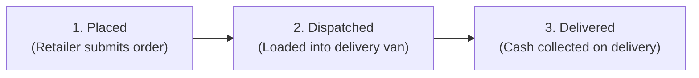

# Kalika Enterprises – Administrative Operations Manual

This guide provides daily operational procedures for business managers and store administrators managing the **Kalika Enterprises** B2B wholesale portal (`/admin/`).

---

## Table of Contents
1. [Administrative Access & Security](#1-administrative-access--security)
2. [Dashboard KPI Overview](#2-dashboard-kpi-overview)
3. [Brand & Manufacturer Management](#3-brand--manufacturer-management)
4. [Product & Variant Catalogue Management](#4-product--variant-catalogue-management)
5. [Bulk Stock & Inventory Updates](#5-bulk-stock--inventory-updates)
6. [Order Processing Pipeline](#6-order-processing-pipeline)
7. [Tax Invoicing & Printing](#7-tax-invoicing--printing)
8. [Customer Directory & Account Controls](#8-customer-directory--account-controls)
9. [Enterprise Settings & Policy Texts](#9-enterprise-settings--policy-texts)
10. [Contact Inquiries Management](#10-contact-inquiries-management)
11. [Password Security & Credential Rotation](#11-password-security--credential-rotation)

---

## 1. Administrative Access & Security

### Portal URL
Access the admin portal at:
```
https://yourdomain.com/admin/login.php
```

### Sign-In Procedure
1. Enter your **Username** and **Password**.
2. Click **Sign In to Dashboard**.
3. **Security Safeguards**:
   - The login form enforces rate-limiting: 5 consecutive failed attempts trigger an automatic **15-minute IP lockout**.
   - Admin sessions expire automatically after **2 hours of inactivity**.
   - All actions are authenticated with CSRF tokens.

```
+-----------------------------------------------------------+
|                     KALIKA ENTERPRISES                    |
|                      Admin Portal Login                   |
|                                                           |
|  Username: [ admin               ]                        |
|  Password: [ •••••••••••••       ]                        |
|                                                           |
|                  [ Sign In to Dashboard ]                 |
+-----------------------------------------------------------+
```

---

## 2. Dashboard KPI Overview

Upon signing in at `/admin/index.php`, the main dashboard displays six live operational metric cards:

```
+------------------+------------------+------------------+
|  Placed Orders   | Dispatched Orders| Delivered Orders |
|       [ 12 ]     |       [ 4 ]      |      [ 128 ]     |
|  Pending dispatch| In regional van  | Completed sales  |
+------------------+------------------+------------------+
| Total Customers  | Low Stock Alerts |   Pending GST    |
|      [ 45 ]      |       [ 2 ]      |       [ 2 ]      |
| Verified stores  | Qty <= 10 units  | Unconfirmed rate |
+------------------+------------------+------------------+
```

### Key Metrics Explained:
- **Placed Orders**: New incoming wholesale orders awaiting warehouse picking and dispatch.
- **Dispatched Orders**: Consignments currently out for delivery across regional routes (Niphad, Dindori, Chandwad, Sinnar, Yeola).
- **Delivered Orders**: Completed orders where stock was handed over and offline payment collected.
- **Total Customers**: Registered retail grocery shops and institutional buyers.
- **Low Stock Alerts**: Variants with 10 or fewer units remaining in warehouse inventory.
- **Pending GST**: Products with missing or unconfirmed GST percentages (these products are blocked from appearing in the customer storefront).

---

## 3. Brand & Manufacturer Management

Navigate to `/admin/brands.php` to manage brand partnerships.

### Adding a New Brand:
1. Click **Add New Brand** in the top action bar.
2. Enter the **Brand Name** (e.g. `Balaji Wafers`, `Amul`, `Haldiram's`).
3. Set the **Status**:
   - `Active`: Products under this brand will be visible in the storefront catalogue (provided product GST is confirmed).
   - `Inactive`: Immediately hides the brand and all its products from the public catalogue.
4. Click **Save Brand**.

> [!NOTE]
> Brand Publishing Constraint: Unconfirmed brands (e.g., Coca-Cola, Sundar Glucose) are kept inactive in the database until formal wholesale terms and GST tax classifications are confirmed.

---

## 4. Product & Variant Catalogue Management

Navigate to `/admin/products.php` for catalogue listings and `/admin/product-edit.php` for adding/editing items.

### Creating or Editing a Product:
1. Navigate to **Catalogue** &rarr; click **Add Product** (or click **Edit** on an existing item).
2. Fill in the primary product details:
   - **Product Name**: Official wholesale SKU title (e.g., `Campa Cola 500ml Pet Bottle`).
   - **Brand**: Select the appropriate registered brand from the dropdown.
   - **Base Category**: Beverages, Confectionery, Snacks, Grocery, etc.
   - **Description**: Detailed description including case pack details (e.g. `Pack of 24 bottles`).
   - **GST Rate (%)**: **CRITICAL RULE**. Choose `0%`, `5%`, `12%`, `18%`, or `28%`.
   - **Status Toggle**: Set `Active` or `Inactive`.

> [!IMPORTANT]
> **Strict GST Publishing Rule**: The application will reject activating any product if its GST Rate is empty or unconfirmed. If you attempt to activate a product with missing GST, the system will save it as Inactive and display an advisory alert.

### Product Image Upload Guidelines:
- **Formats Allowed**: JPEG (`.jpg`, `.jpeg`), PNG (`.png`), WebP (`.webp`).
- **File Size Limit**: Maximum **2 MB**.
- **Dimensions**: Square 1:1 ratio recommended (e.g., `800 x 800` pixels) on a clean white background.
- Images are automatically validated using PHP `getimagesize()` to prevent malicious scripts from being uploaded.

### Managing Size & Pack Variants:
Wholesale items often come in multiple case sizes or net weights:
1. Scroll down to the **Product Variants** section on the edit screen.
2. For each variant, configure:
   - **Variant Label**: e.g. `200ml`, `500ml`, `2 Litre`, `50g Pack of 30`.
   - **Wholesale Base Price (₹)**: Base price before tax.
   - **Stock Count**: Current inventory units in the warehouse.
   - **Availability**: Mark `In Stock` or `Out of Stock`.
3. To add an additional pack size, click **+ Add Variant Row**.
4. Click **Save Product Changes**.

```
+-------------------------------------------------------------+
| Product: Campa Cola Pet Bottle                              |
| Brand: Campa (Reliance Consumer)       GST Rate: [ 28%  v ] |
| Status: [ Active   v ]                                      |
|                                                             |
| Variants:                                                   |
| [ 200ml (Tray of 24) ] Price: ₹240.00 Stock: 150 [In Stock] |
| [ 500ml (Tray of 24) ] Price: ₹480.00 Stock:  85 [In Stock] |
| [ 2Litre (Pack of 6) ] Price: ₹420.00 Stock:  30 [In Stock] |
|                                                             |
| [ + Add Another Variant ]                                   |
|                                         [ Save Changes ]    |
+-------------------------------------------------------------+
```

---

## 5. Bulk Stock & Inventory Updates

During daily morning warehouse counts, navigate to `/admin/stock.php` for rapid inventory adjustments across all SKUs without opening individual product edit screens.

### How to Perform Bulk Stock Updates:
1. Open `/admin/stock.php`.
2. Filter by **Brand** or search by SKU title if needed.
3. Edit the numbers directly in the **Stock Quantity** inputs.
4. Toggle the **In Stock / Out of Stock** select inputs.
5. Click **Update All Stock** at the bottom of the table.
6. The entire inventory batch is committed atomically in a single database transaction.

---

## 6. Order Processing Pipeline

Navigate to `/admin/orders.php` to monitor incoming customer orders.

### Wholesale Order Workflow:
Every wholesale order progresses strictly through three sequential milestones:



### Step-by-Step Order Handling:
1. **New Order Notification (`Placed`)**:
   - Customer placed an order meeting the **₹2,000 minimum threshold**.
   - Review the order details, items, quantities, and delivery address in `/admin/order-detail.php?id=[order_id]`.
   - Pick the required cases from the warehouse.
2. **Advancing to `Dispatched`**:
   - When goods are loaded onto the delivery van for the scheduled regional route (Niphad, Dindori, Chandwad, Sinnar, or Yeola):
   - In the **Update Status** dropdown, select **Dispatched**.
   - Click **Update Status**.
   - The customer's order tracker will immediately show the delivery vehicle en route.
3. **Completing as `Delivered`**:
   - Van driver hands over the shipment to the shopkeeper and collects the invoice total in cash or offline UPI.
   - Select **Delivered** and click **Update Status**.
   - The order is archived in the completed sales ledger.

> [!NOTE]
> Offline Payment Rule: Kalika Enterprises operates strictly on cash/offline payment on delivery. Online credit cards, debit cards, and payment gateways are disabled by policy.

---

## 7. Tax Invoicing & Printing

Every order produces a standard GST Tax Invoice compliant with Indian commercial tax requirements.

### How to Print an Invoice:
1. In `/admin/orders.php` or inside `/admin/order-detail.php`, click **Print Invoice**.
2. The print layout opens at `/public/invoice.php?order=[id]`.
3. The invoice automatically includes:
   - **Kalika Enterprises** header with Nashik warehouse address and GSTIN.
   - Customer trading name, delivery address, and registered mobile number.
   - Unique order reference: `KE-YYYYMMDD-XXXX`.
   - Itemized table with HSN/SAC codes, quantity, unit rate, GST rate (%), CGST, SGST, and total value.
   - Prominent stamp: **"PAYMENT TERMS: CASH / OFFLINE PAYMENT ON DELIVERY"**.
4. Press `Ctrl + P` (or `Cmd + P` on Mac) to send to your office laser printer on standard A4 paper.

---

## 8. Customer Directory & Account Controls

Navigate to `/admin/customers.php` to view registered retail accounts.

- **Customer Information**: View registered trading name, shopkeeper name, mobile number, delivery territory, registration date, order count, and lifetime spend.
- **Account Status**:
  - `Active`: Can sign in, view wholesale prices, and submit orders.
  - `Suspended`: Temporarily blocked from ordering. Use this if a retailer has unpaid balances or invalid business credentials.

---

## 9. Enterprise Settings & Policy Texts

Navigate to `/admin/settings.php` to configure business-wide parameters:

### Core Configuration Parameters:
- **Enterprise Name**: `Kalika Enterprises`
- **Wholesale Contact Phone**: `+91 98220 XXXXX`
- **Warehouse Address**: Physical warehouse address for dispatch and invoices.
- **GSTIN**: 15-character GST registration number.
- **FSSAI License Number**: 14-digit food safety license.
- **Minimum Order Threshold (₹)**: Default is `2000.00`. Retail checkout is mathematically blocked if the cart subtotal is less than this value.
- **Free Delivery Notice**: Free delivery covers Niphad, Dindori, Chandwad, Sinnar, and Yeola.
- **Storefront Policy Editors**: Rich text editors for *Delivery Policy*, *Return & Replacement Policy*, and *Payment Terms*.

---

## 10. Contact Inquiries Management

Customer inquiries sent via the public contact form (`/public/contact.php`) arrive in the administrative inbox at `/admin/messages.php`.

- Review customer queries, shop names, and mobile numbers.
- Mark inquiries as **Read** or **Unread**.
- Contact the prospective retailer directly by phone for bulk onboarding.

---

## 11. Password Security & Credential Rotation

To rotate your administrative password:
1. Click **Account** &rarr; **Change Password** in the top navigation bar (`/admin/change-password.php`).
2. Enter your **Current Password**.
3. Enter your **New Password** (minimum 10 characters; must include uppercase, lowercase, numbers, and symbols).
4. Re-enter the new password to confirm.
5. Click **Update Password**.
6. **Best Practice**: Rotate the administrator password every 90 days.
