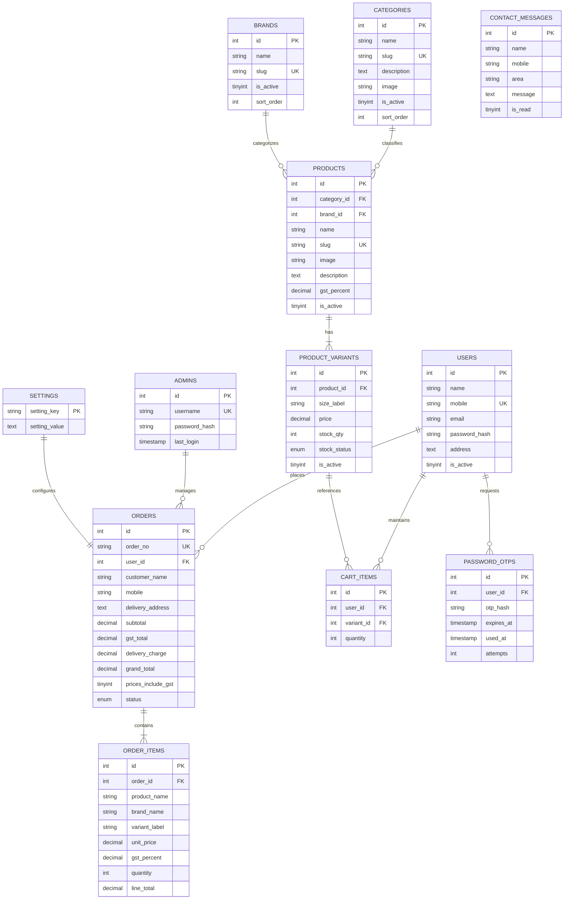

# Kalika Enterprises – Database Architecture Specification

This document provides the Entity-Relationship (ER) model, table definitions, indexing strategy, and seed data baseline for the Kalika Enterprises food and beverage distribution web application.

---

## 1. Entity-Relationship Overview

---

## 2. Table Specifications

### 2.1 `brands`
Stores manufacturer brands. Only active brands appear in the public storefront filter.
- `id`: `INT UNSIGNED AUTO_INCREMENT PRIMARY KEY`
- `name`: `VARCHAR(100) NOT NULL` (e.g., Campa, Euro Chips)
- `slug`: `VARCHAR(100) NOT NULL UNIQUE`
- `is_active`: `TINYINT(1) DEFAULT 1`
- `sort_order`: `INT DEFAULT 0`

### 2.2 `products`
FMCG product lines assigned to brands.
- `id`: `INT UNSIGNED AUTO_INCREMENT PRIMARY KEY`
- `brand_id`: `INT UNSIGNED NOT NULL, FK -> brands(id)`
- `name`: `VARCHAR(150) NOT NULL` (e.g., Campa Cola, Euro Chips Masala)
- `slug`: `VARCHAR(150) NOT NULL UNIQUE`
- `image`: `VARCHAR(255) NULL` (Path in `/public/uploads/products/` or `NULL` for placeholder)
- `description`: `TEXT NULL`
- `gst_percent`: `DECIMAL(5,2) NULL` (Flagged as "GST pending" when NULL)
- `is_active`: `TINYINT(1) DEFAULT 1` (Cannot be published if GST is NULL)

### 2.3 `product_variants`
Pack sizes, weights, and bottle capacities with discrete stock tracking.
- `id`: `INT UNSIGNED AUTO_INCREMENT PRIMARY KEY`
- `product_id`: `INT UNSIGNED NOT NULL, FK -> products(id)`
- `size_label`: `VARCHAR(100) NOT NULL` (e.g., 200ml, 500ml, 16g, 500g)
- `price`: `DECIMAL(10,2) NOT NULL` (Wholesale unit price in INR)
- `stock_qty`: `INT NOT NULL DEFAULT 0`
- `stock_status`: `ENUM('in_stock', 'out_of_stock') DEFAULT 'in_stock'`
- `is_active`: `TINYINT(1) DEFAULT 1`

### 2.4 `users`
Customer accounts representing regional retail shops.
- `id`: `INT UNSIGNED AUTO_INCREMENT PRIMARY KEY`
- `name`: `VARCHAR(100) NOT NULL`
- `mobile`: `VARCHAR(15) NOT NULL UNIQUE` (10-digit Indian format)
- `email`: `VARCHAR(150) NULL`
- `password_hash`: `VARCHAR(255) NOT NULL` (Bcrypt)
- `address`: `TEXT NOT NULL`
- `is_active`: `TINYINT(1) DEFAULT 1`

### 2.5 `orders`
Wholesale orders placed by verified retail accounts.
- `id`: `INT UNSIGNED AUTO_INCREMENT PRIMARY KEY`
- `order_no`: `VARCHAR(50) NOT NULL UNIQUE` (Format: `KE-YYYYMMDD-XXXX`)
- `user_id`: `INT UNSIGNED NOT NULL, FK -> users(id)`
- `customer_name`: `VARCHAR(100) NOT NULL`
- `mobile`: `VARCHAR(15) NOT NULL`
- `delivery_address`: `TEXT NOT NULL`
- `subtotal`: `DECIMAL(10,2) NOT NULL` (Minimum ₹2,000 threshold enforced)
- `gst_total`: `DECIMAL(10,2) NOT NULL`
- `delivery_charge`: `DECIMAL(10,2) NOT NULL DEFAULT 0.00` (Always FREE)
- `grand_total`: `DECIMAL(10,2) NOT NULL`
- `prices_include_gst`: `TINYINT(1) NOT NULL DEFAULT 1`
- `status`: `ENUM('Placed', 'Dispatched', 'Delivered') DEFAULT 'Placed'`

### 2.6 `order_items`
Immutable historical snapshot of purchased items. Even if an admin updates product names, prices, or GST later, historical orders and invoices remain unchanged.
- `id`: `INT UNSIGNED AUTO_INCREMENT PRIMARY KEY`
- `order_id`: `INT UNSIGNED NOT NULL, FK -> orders(id)`
- `product_name`: `VARCHAR(150) NOT NULL`
- `brand_name`: `VARCHAR(100) NOT NULL`
- `variant_label`: `VARCHAR(100) NOT NULL`
- `unit_price`: `DECIMAL(10,2) NOT NULL`
- `gst_percent`: `DECIMAL(5,2) NOT NULL`
- `quantity`: `INT UNSIGNED NOT NULL`
- `line_total`: `DECIMAL(10,2) NOT NULL`

### 2.7 `cart_items`
Persistent shopping cart for authenticated users.
- `id`: `INT UNSIGNED AUTO_INCREMENT PRIMARY KEY`
- `user_id`: `INT UNSIGNED NOT NULL, FK -> users(id)`
- `variant_id`: `INT UNSIGNED NOT NULL, FK -> product_variants(id)`
- `quantity`: `INT UNSIGNED NOT NULL DEFAULT 1`
- `UNIQUE KEY`: `(user_id, variant_id)`

### 2.8 `password_otps`
Stores single-use, 5-minute expiring OTP hashes for customer password recovery.
- `id`: `INT UNSIGNED AUTO_INCREMENT PRIMARY KEY`
- `user_id`: `INT UNSIGNED NOT NULL, FK -> users(id)`
- `otp_hash`: `VARCHAR(255) NOT NULL`
- `expires_at`: `TIMESTAMP NOT NULL`
- `used_at`: `TIMESTAMP NULL`
- `attempts`: `INT UNSIGNED DEFAULT 0`

### 2.9 `login_attempts`
Tracks failed sign-ins for rate limiting against brute force attempts.
- `id`: `INT UNSIGNED AUTO_INCREMENT PRIMARY KEY`
- `identifier`: `VARCHAR(100) NOT NULL` (Mobile or username)
- `ip`: `VARCHAR(45) NOT NULL`
- `attempted_at`: `TIMESTAMP DEFAULT CURRENT_TIMESTAMP`

### 2.10 `admins`
Internal store operations credentials.
- `id`: `INT UNSIGNED AUTO_INCREMENT PRIMARY KEY`
- `username`: `VARCHAR(50) NOT NULL UNIQUE`
- `password_hash`: `VARCHAR(255) NOT NULL`
- `last_login`: `TIMESTAMP NULL`

### 2.11 `settings`
Key-value store for global configurations, business details, and policies.
- `setting_key`: `VARCHAR(100) PRIMARY KEY`
- `setting_value`: `TEXT NOT NULL`

### 2.12 `contact_messages`
Stores customer and retail inquiry submissions.
- `id`: `INT UNSIGNED AUTO_INCREMENT PRIMARY KEY`
- `name`: `VARCHAR(100) NOT NULL`
- `mobile`: `VARCHAR(15) NOT NULL`
- `area`: `VARCHAR(100) NOT NULL`
- `message`: `TEXT NOT NULL`
- `is_read`: `TINYINT(1) DEFAULT 0`

---

## 3. Seed Inventory Breakdown

| Brand Name | Status | Products | Variants | Sample Variant Rates |
|---|---|---|---|---|
| **Campa** | Active (GST 28%*) | Campa Cola, Orange, Jeera, Lemon (4) | 16 (4 variants each) | 200ml (₹10), 500ml (₹20), 700ml (₹35), 1L (₹80) |
| **Sundar Marie** | Active (GST 5%*) | Sundar Marie (1) | 3 | 20g (₹5), 45g (₹10), 95g (₹20) |
| **Sundar Bourbon**| Active (GST 18%*)| Sundar Bourbon (1) | 1 | 500g (₹65) |
| **Sundar Coconut**| Active (GST 18%*)| Sundar Coconut (1) | 4 | 20g (₹5), 50g (₹10), 200g (₹30), 400g (₹55) |
| **Sundar Glucose**| Inactive (GST Pending)| Sundar Glucose (1) | 3 (Inactive) | 20g (₹5), 45g (₹10), 95g (₹20) |
| **Euro Chips** | Active (GST 12%*) | Salted, Masala, Banana Chips (3) | 12 (4 variants each)| 16g (₹5), 35g (₹10), 70g (₹20), 160g (₹50) |
| **Coca-Cola Range**| Inactive (Specs Pending)| Thums Up, Sprite (2) | 0 (No variants) | Seeded inactive with no variants |
| **Total Baseline**| **7 Brands** | **13 Products** | **39 Variants** | – |

*\*GST rates are subject to final client CA verification as recorded in `TODO_CONFIRM.md`.*
