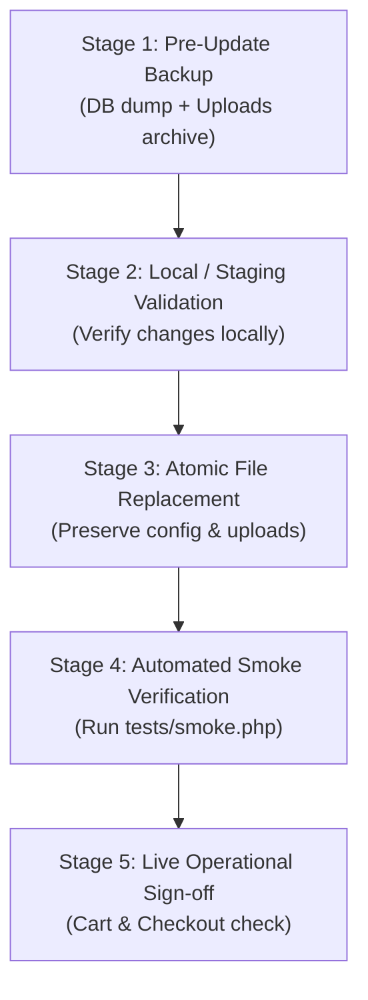

# Kalika Enterprises – System Maintenance & Code Update Guide

This technical guide outlines maintenance routines, safe code deployment procedures, credential rotation, and routine system health checks for administrators and technical maintainers of the **Kalika Enterprises** web platform.

---

## 1. Safe Code Update Procedure

Whenever modifying PHP scripts, CSS stylesheets, or template files, always follow this 5-stage deployment protocol to prevent production downtime.



### Stage 1: Pre-Update Backup
Never deploy code changes to the live production server without an immediate snapshot:
1. Export the live database:
   ```bash
   mysqldump -u username -p kalika_enterprises > pre_update_$(date +%Y%m%d_%H%M%S).sql
   ```
2. Archive the current codebase:
   ```bash
   tar -czf pre_update_code_$(date +%Y%m%d).tar.gz --exclude="public/uploads" /home/username/public_html/
   ```

### Stage 2: Local Validation
- Test all code changes locally first (e.g. PHP 8.x + MySQL 8.0 on your development machine).
- Ensure error reporting displays no PHP warnings, notices, or deprecated function calls.

### Stage 3: Atomic File Deployment
- When uploading updated files via SFTP or Git:
- **PROTECTED FILES (NEVER OVERWRITE ON PRODUCTION)**:
  - `config/config.php` (contains live hosting database credentials and production flags).
  - `public/uploads/` (contains all live customer-uploaded and product packshot images).
  - `database/backups/` (contains rolling daily database dumps).
  - `logs/` (contains historical audit and error logs).

### Stage 4: Smoke Test Verification
Immediately following file upload, run the automated test suite:
1. Open `https://yourdomain.com/tests/smoke.php` in your browser.
2. Confirm that all 43 automated assertions return `[PASS]`.
3. Verify database connectivity, session tables, and route availability.

### Stage 5: Rollback Strategy
If any fatal error occurs during deployment:
1. Restore the code archive:
   ```bash
   tar -xzf pre_update_code_YYYYMMDD.tar.gz -C /home/username/public_html/
   ```
2. If database schema was altered, restore `pre_update_YYYYMMDD.sql`.
3. Check `/logs/php_errors.log` to diagnose the root cause before attempting redeployment.

---

## 2. Managing Database Schema Changes

When introducing new database tables or columns:
1. **Additive Changes Only**: Use `ALTER TABLE ... ADD COLUMN` rather than dropping or renaming existing columns.
2. **Backwards Compatibility**: Provide sensible default values for new columns (e.g., `DEFAULT 0` or `DEFAULT ''`) so existing code does not fail.
3. **Execution**: Execute the SQL migration script via phpMyAdmin or command-line MySQL *before* deploying code that relies on the new schema.

---

## 3. Administrative Credential Rotation

### Standard Rotation (Every 90 Days)
1. Sign in to `/admin/login.php`.
2. Navigate to **Account** &rarr; **Change Password** (`/admin/change-password.php`).
3. Enter the current password, then provide a new strong password (minimum 12 characters combining uppercase, lowercase, numbers, and symbols).
4. Save changes. The system automatically computes a new Bcrypt hash with cost factor 12.

### Emergency Password Reset (Lost Credentials)
If the administrator password is lost or forgotten:
1. Generate a new Bcrypt hash using PHP CLI on your local terminal:
   ```bash
   php -r "echo password_hash('NewSecurePassword123!', PASSWORD_BCRYPT, ['cost' => 12]) . PHP_EOL;"
   ```
2. Open phpMyAdmin on your hosting server.
3. Select the `admins` table.
4. Edit the target administrator row (e.g., `id = 1`) and paste the newly generated `$2y$12$...` hash into the `password_hash` column.
5. Save the row. You can now immediately sign in with `NewSecurePassword123!`.

---

## 4. Brand & Product Maintenance Workflows

### Onboarding a New Brand:
1. Verify wholesale distribution agreements and obtain official brand logo packshot.
2. Sign in to `/admin/brands.php` &rarr; click **Add New Brand**.
3. Set the brand name and save as `Active`.
4. Create the brand's products in `/admin/product-edit.php`:
   - Specify accurate case pack descriptions.
   - **Mandatory**: Set the verified GST percentage (`0%`, `5%`, `12%`, `18%`, or `28%`).
   - Upload high-resolution 1:1 square packshots (under 2 MB).
   - Configure pack sizes/variants with base wholesale prices.

### Removing or Deactivating Products:
- **Soft Deletion**: If a product has historical sales records, do not delete it from the database (to preserve order history and invoice integrity). Instead, edit the product and set its **Status** to `Inactive`. It will disappear from the storefront while keeping past tax invoices intact.

---

## 5. Scheduled Maintenance Checklist

### Weekly Maintenance (Every Monday Morning)
- [ ] **Verify Daily Backups**: Check `/database/backups/` to confirm that 14 daily `.sql` dumps are being maintained.
- [ ] **Off-site Sync**: Download the latest weekly `.sql` dump and store it in secure off-site company storage.
- [ ] **Pending Orders Audit**: Check `/admin/orders.php` for any orders lingering in `Placed` status for longer than 24 hours.

### Monthly Maintenance (1st of Each Month)
- [ ] **Log File Inspection & Rotation**:
  - Check the size of `/logs/php_errors.log`.
  - If the log file exceeds 10 MB, archive it as `logs/php_errors_YYYYMM.log` and create a fresh empty log file.
- [ ] **Disk Usage Review**:
  - Check cPanel storage quotas to ensure `/public/uploads/` is not consuming excessive disk space.
- [ ] **Customer Audit**:
  - Review `/admin/customers.php` for any suspended accounts or repeated failed login attempts recorded in `login_attempts`.
- [ ] **Inventory Reconciliation**:
  - Run physical inventory counts against `/admin/stock.php` quantities and update stock levels.

### Quarterly Maintenance (Every 3 Months)
- [ ] **Rotate Master Admin Password**: Update credentials via `/admin/change-password.php`.
- [ ] **Security Permissions Check**: Verify file and folder permissions across the server:
  - Folders: `0755`
  - Files: `0644`
  - Ensure `.htaccess` blocks remain active in `config/`, `database/`, `docs/`, `includes/`, and `logs/`.
- [ ] **Server Software Check**: Verify that the hosting server runs supported PHP versions (PHP 8.1+) and MySQL 8.0+.
- [ ] **Full Disaster Recovery Drill**: Perform a test restore of the latest SQL dump into a staging or local database to guarantee backup integrity.
